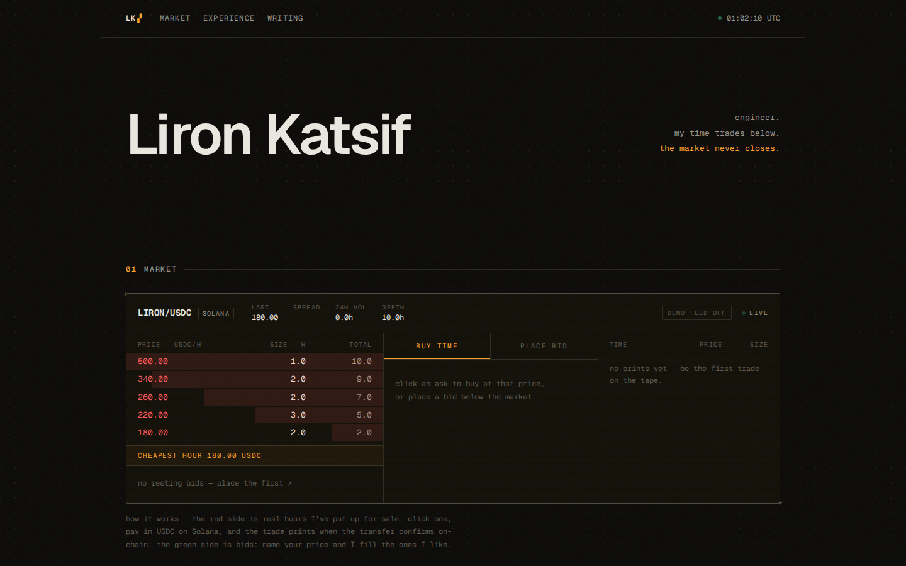
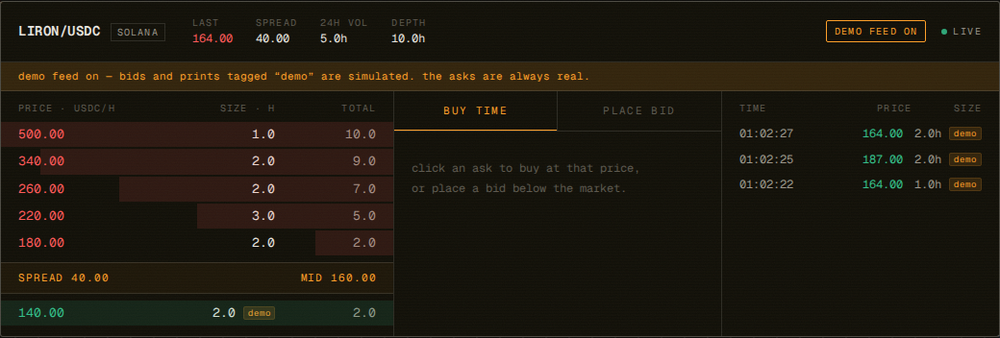
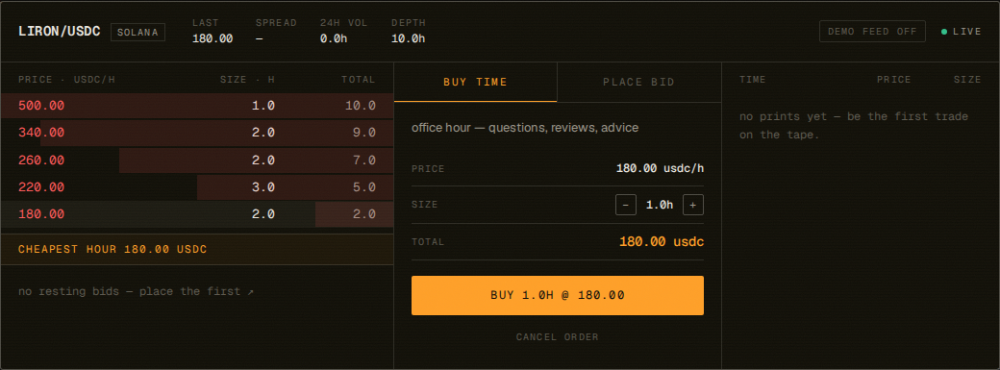
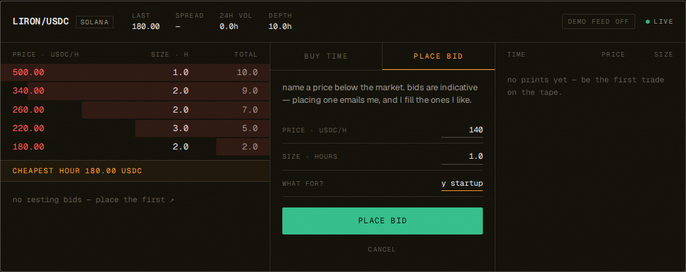
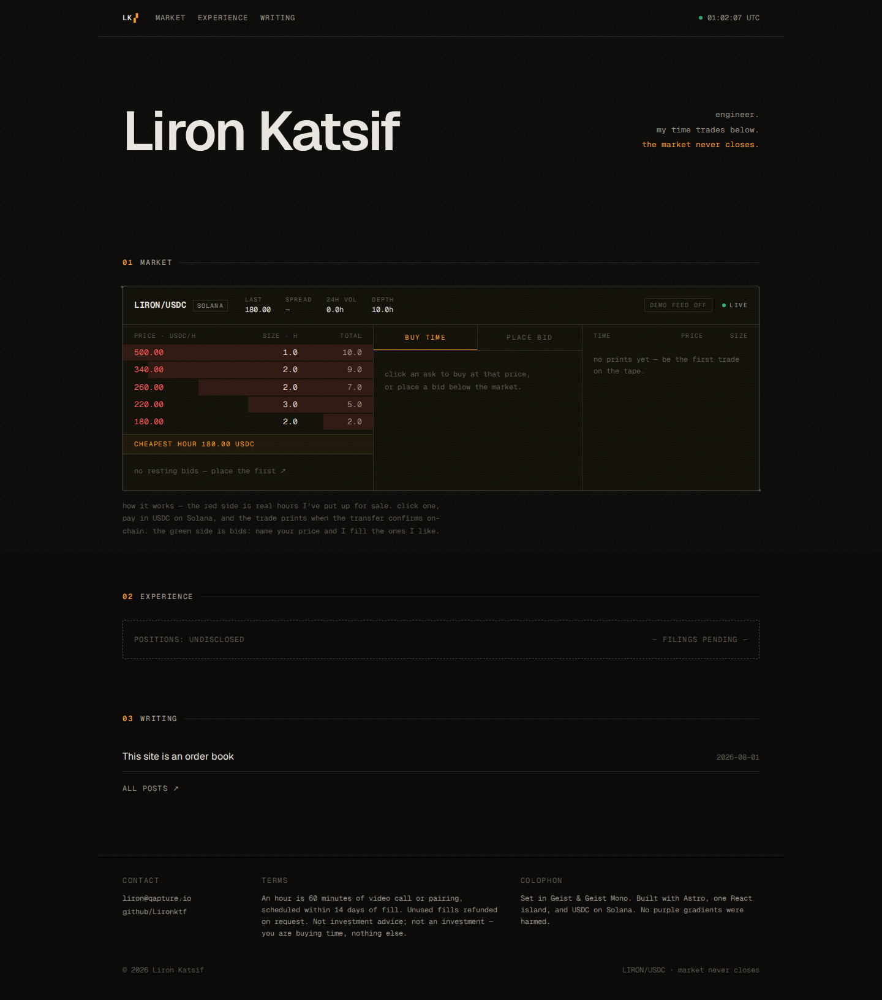
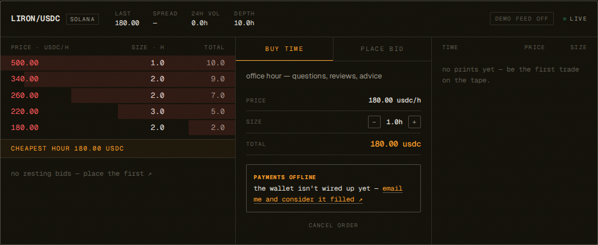
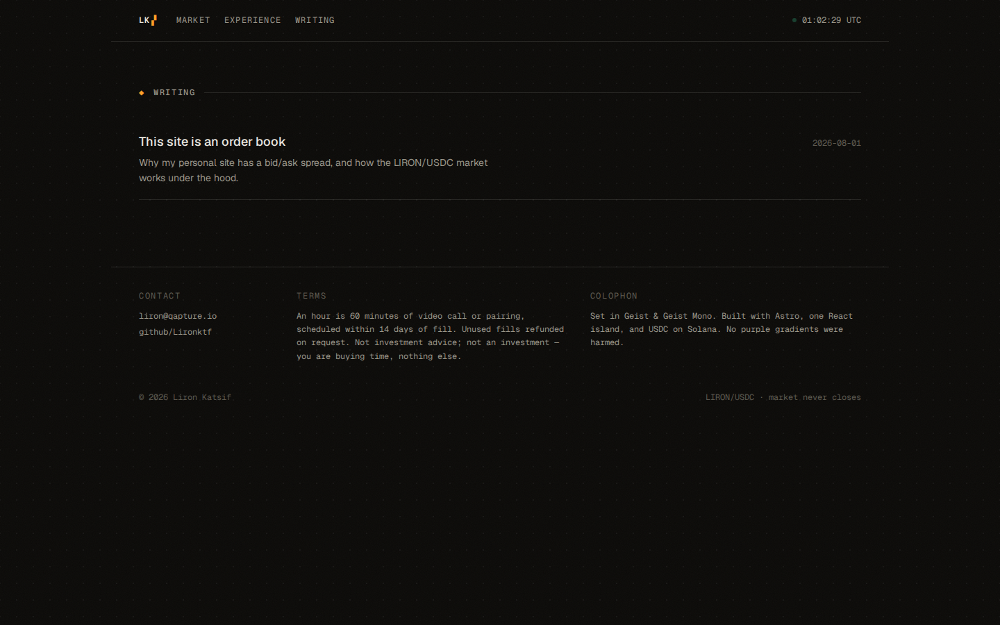
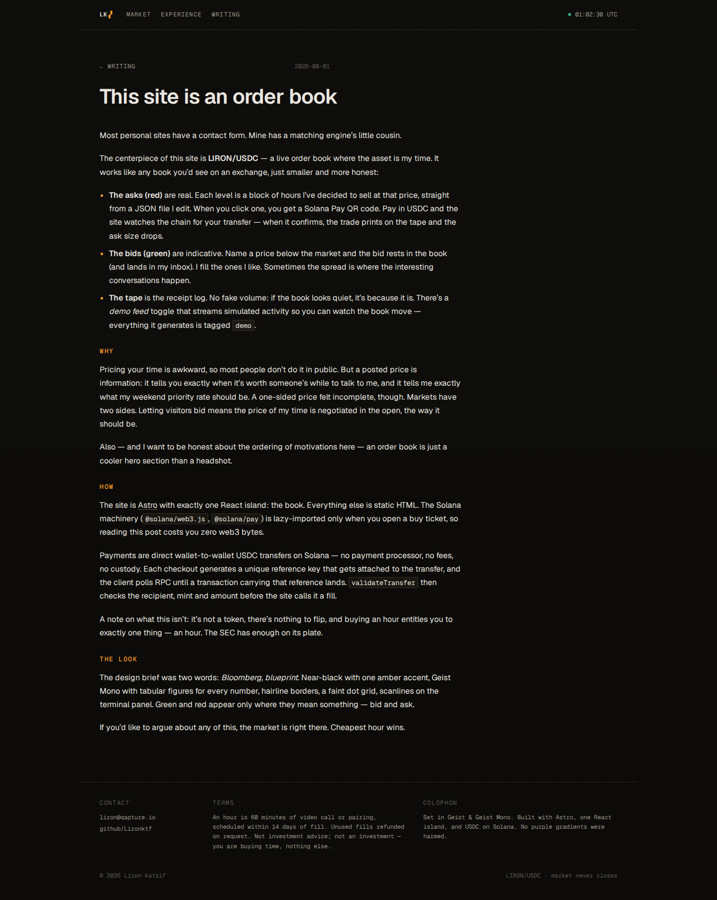
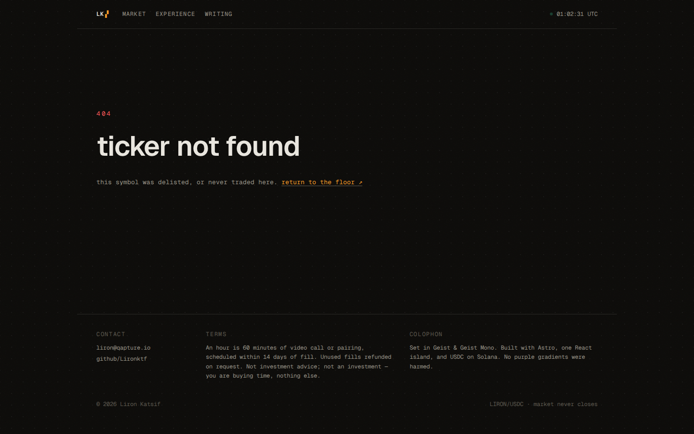
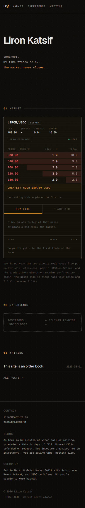

# lironkatsif.com

Personal site of Liron Katsif. Most personal sites have a contact form — this
one has an order book.



## LIRON/USDC

The centerpiece is a live order book where the asset is my time:

- **Asks (red)** are real, bookable hours at prices I set in
  [`src/data/asks.json`](src/data/asks.json). Click one → Solana Pay QR →
  pay in USDC → the site watches the chain and prints the trade when your
  transfer confirms.
- **Bids (green)** are indicative. Name a price below the market; the bid
  rests in the book and lands in my inbox. I fill the ones I like.
- **The tape** shows fills. No fake volume — a *demo feed* toggle streams
  simulated activity for the curious, and everything it generates is tagged
  `demo`.



### Payment flow

Direct wallet-to-wallet USDC on Solana via `@solana/pay` — no processor, no
fees, no custody. Each checkout generates a unique reference key; the client
polls RPC (`findReference`) until a transaction carrying it lands, then
`validateTransfer` checks recipient, mint and amount before the fill prints.
All web3 code is lazy-imported — it costs zero bytes until someone opens a
buy ticket.




## Stack

- [Astro](https://astro.build) — static output, MDX blog, Shiki (`vesper`),
  native cross-document view transitions
- One React island: [`src/islands/orderbook`](src/islands/orderbook)
- `@solana/web3.js` + `@solana/pay` + `qrcode` (lazy-loaded)
- Geist Sans / Geist Mono, self-hosted via Fontsource
- Plain CSS custom properties — no framework

### Design

Two words: *Bloomberg, blueprint.* Near-black with a single amber accent,
tabular-figure mono for every number, 1px hairlines, a faint 24px dot grid,
scanlines on the terminal panel, 150–250ms ease-out motion. Green and red
appear only where they mean something: bid and ask.

## Running it

```sh
npm install
npm run dev        # localhost:4321
npm run build      # static site → dist/
```

Screenshots (requires `npx playwright install chromium` and a running
`npm run preview`):

```sh
node scripts/screenshots.mjs
```

## Configuration

Everything lives in [`src/config.ts`](src/config.ts):

| key          | what                                                            |
| ------------ | --------------------------------------------------------------- |
| `solAddress` | your Solana wallet (base58). Empty = buy flow shows a graceful "payments offline" state |
| `bookingUrl` | link revealed after a fill (e.g. cal.com). Empty = email fallback |
| `rpc`        | Solana RPC endpoint used for payment confirmation                |

Inventory is [`src/data/asks.json`](src/data/asks.json); experience entries
are [`src/data/experience.json`](src/data/experience.json) (currently empty —
the section renders a "positions: undisclosed" state).

## Gallery

| | |
|---|---|
|  |  |
|  |  |
|  |  |

---

Built with [Claude Code](https://claude.com/claude-code).
